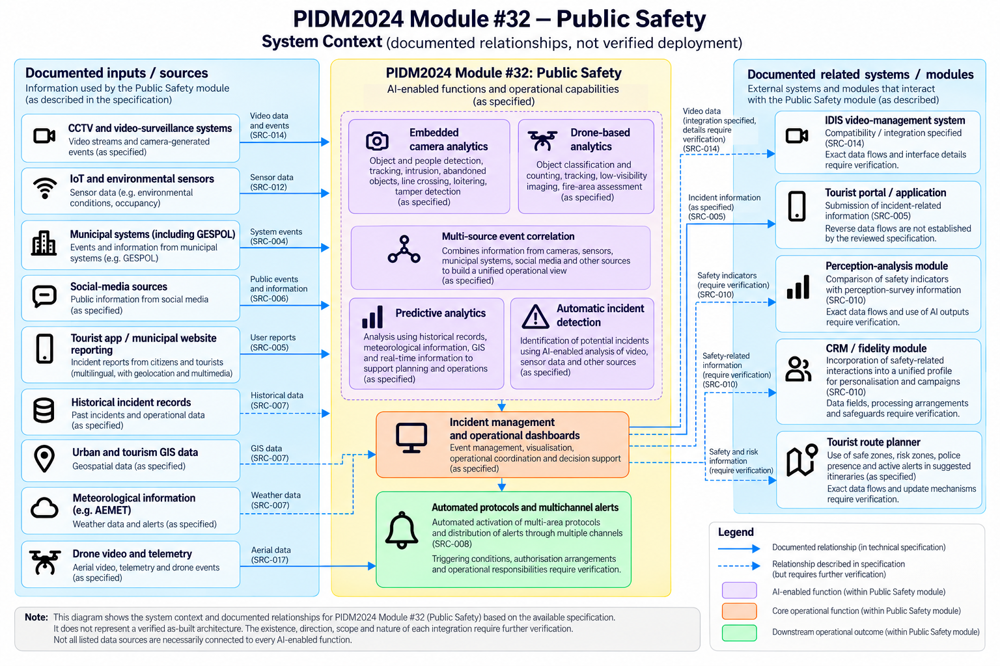

# Public Safety System Context

## 1. Purpose

This document presents a visual overview of the documented system context for PIDM2024 Module #32 (Public Safety), based on the reviewed technical procurement specification.

It identifies documented information sources, AI-enabled functions, operational outputs, and relationships with other systems and modules.

The diagram is an analytical representation of the specification, not a verified as-built architecture.

## 2. System Context Diagram

*Figure 1. Public Safety system context based on the reviewed technical specification. Documented relationships and relationships requiring verification are distinguished in the illustration.*

## 3. Interpretation

The diagram groups the documented context into three areas:

- **Documented inputs and sources:** Information sources described in the specification as relevant to the Public Safety module.
- **Public Safety module:** The AI-enabled functions and operational capabilities described for Module #32.
- **Related systems and modules:** Other systems and PIDM2024 components with documented relationships to Public Safety.

The specification describes automatic incident detection, multi-source event correlation, predictive analytics, embedded camera analytics, drone-based analytics, incident-management functions, and automated protocols or multichannel alerts.

These capabilities should not be treated as one model or as a single verified processing pipeline. The exact technical relationships between functions require further evidence.

## 4. Evidence and Limitations

- The diagram represents documented requirements and relationships, not proof of implementation or live operation.
- The specification does not establish the deployed configuration, performance, or effectiveness of the listed AI-enabled functions.
- The precise relationship between camera analytics and automatic incident detection remains to be verified.
- The technical mechanism used for multi-source event correlation is not fully established by the reviewed passages.
- The relationship between AI-generated information and the triggering or authorisation of operational protocols requires further verification.
- Cross-module relationships involving the tourist portal and application, perception-analysis module, CRM/fidelity module, and route planner do not establish verified live data flows or the safeguards implemented for those flows.

The questions in this document are not findings of confirmed control failures, legal violations, or non-compliance.

## 5. Traceability

The diagram should be read alongside the existing source-requirements and evidence-gaps registers.

Relevant source requirements include:

- **SRC-004:** GESPOL integration and bidirectional data flows.
- **SRC-005:** Tourist portal and application incident reporting.
- **SRC-006:** Multi-source event correlation.
- **SRC-007:** Predictive analytics.
- **SRC-008:** Automated protocols and multichannel alerts.
- **SRC-009:** Automatic incident detection.
- **SRC-010:** Safety-related information and CRM profile relationships.
- **SRC-012:** Data sources and outputs.
- **SRC-014–SRC-017:** Camera, recording infrastructure, control-room infrastructure, and drone requirements.

**Broader platform architecture:** Section 6.3, “ARQUITECTURA DE LA PIDM24,” printed page 41, provides a platform-level architecture view covering support, interoperability, knowledge processing, acquisition/interconnection, and external systems. It provides context for understanding Module #32 within PIDM24, but does not by itself establish which platform components are connected to Public Safety or verify the implementation of specific data flows.

Relevant evidence gaps include **EG-001–EG-008**, covering human oversight, model validation, monitoring, incident management, accountability and change control, data governance, implementation verification, and external data-source integration.

These references identify relevant records for further assessment. They do not establish that requirements have been fulfilled or that controls are effective.

## 6. Status

**Status:** Initial system context representation based on the reviewed procurement specification.

Before publication, verify that the illustration's labels, arrows, and relationship classifications accurately reflect the cited source passages. Any relationship that cannot be substantiated should be corrected or explicitly marked as requiring verification.